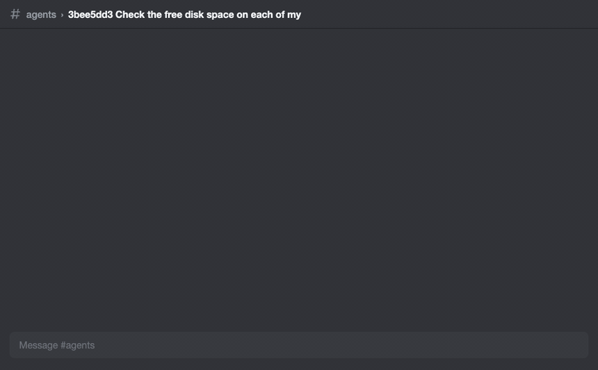
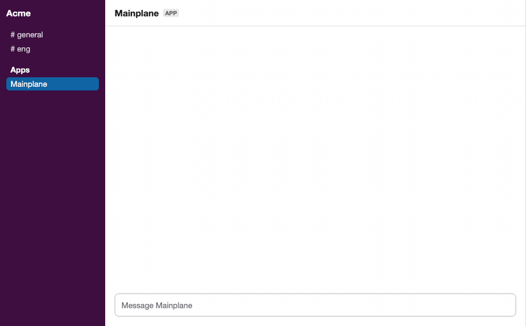

# mainplane-chat

**Talk to your [Mainplane](https://github.com/mainplane-ai/mainplane) agents from Discord and Slack.** Every session is a thread. You see the agent work live, stop it with a button, send it files, and get files back. Long tasks keep going past the context limit on their own.

<p align="center">
  
</p>

[Mainplane](https://github.com/mainplane-ai/mainplane) is an open-source agent harness. It runs agents on any model and lets them control your computers. You message the agents through connectors, such as its terminal app and CLI. mainplane-chat adds Discord and Slack as connectors. It is a small Go service that runs next to your Mainplane server and talks to its API.

```
 Discord server ─┐                                   ┌─ worker: server
                 ├─ mainplane-chat ─ Mainplane server ┼─ worker: laptop
 Slack DMs ──────┘                                   └─ worker: ...
```

> mainplane-chat is a community project. It is not made by or affiliated with the Mainplane team.

## Features

- **A thread per session.** A message in a channel (Discord), or a DM or a mention of the app in a Slack channel or group DM, starts a session in a thread. Replies in the thread continue it.
- **Live status.** One message shows the running turn: its time, its last tool calls and a Stop button. When the turn ends, it shrinks to one line: `14 calls · 2m31s · 38% context`.
- **Files in both directions.** Send images and text files with a message. The agent sends a file back with a line `attach: /path/to/file` in its reply.
- **Every connector, one conversation.** Sessions started in the terminal app or CLI get a thread in `#sessions`. Messages sent from elsewhere show in the thread with their source.
- **Recovery.** A failed step comes with a Retry button and a model picker. When a provider's quota runs out, continue on another model in one click.
- **No context limit.** When a session fills its context, the bot continues it in a new session and passes on the last message. The thread follows.
- **Catches up.** What happens while the bot is down is picked up when it starts again.
- **Slack agent sessions.** In Slack, a thread is a native agent session, with its title, working state and Stop button.

<p align="center">
  
</p>

<sub>The demos are re-creations of real sessions, with the worker names changed.</sub>

## Setup

You need a running [Mainplane server](https://github.com/mainplane-ai/mainplane#self-hosting-quickstart) and Go 1.27 or later. Run mainplane-chat on the same machine as the server. Use Discord, Slack or both.

1. Make a harness key for the bot:

   ```sh
   mainplane-server key new chat
   ```

2. For Discord, make a bot in the [Developer Portal](https://discord.com/developers/applications). Turn on the **Message Content** intent. Invite it to a private server with permission to read and send messages, manage threads, add reactions and attach files. Make a text channel named `sessions` for sessions started outside Discord.

3. For Slack, make an app [from the manifest](https://api.slack.com/apps?new_app=1) in [`slack-manifest.yaml`](slack-manifest.yaml) and install it to your workspace. Make an app-level token with `connections:write` for Socket Mode. An app made from an older manifest needs the new events and scopes, then a reinstall, before it hears channels and group DMs.

4. Install and run:

   ```sh
   go install github.com/0x7067/mainplane-chat@latest
   mainplane-chat
   ```

   To keep it running, use a systemd user service or similar, with the environment below in an env file. On macOS, use a user LaunchAgent with `RunAtLoad` and `KeepAlive`, whose program is `/bin/zsh -c 'set -a; source $HOME/.config/mainplane-chat/env; exec $HOME/.local/bin/mainplane-chat'`, and restart it with `launchctl kickstart -k gui/$(id -u)/<label>`.

| Variable | |
| --- | --- |
| `MAINPLANE_KEY` | the harness key from step 1 |
| `MAINPLANE_URL` | the harness URL; default `http://127.0.0.1:8080` |
| `DISCORD_TOKEN` | the Discord bot token; leave it unset to run Slack only |
| `SLACK_BOT_TOKEN` | the `xoxb-` token of the Slack app; leave it unset to run Discord only |
| `SLACK_APP_TOKEN` | the `xapp-` app-level token, with Slack |
| `MAINPLANE_SLACK_USERS` | with Slack: comma-separated Slack user ids the bot takes messages from |
| `MAINPLANE_DISCORD_TESTER` | optional: the user id of a tester bot whose messages the bot takes as a person's, for end-to-end tests. Other bots stay ignored |

The bot keeps its state in `$XDG_STATE_HOME/mainplane-chat/state.json` (`~/.local/state` by default).

**Security:** anyone who can post in the Discord server, or any Slack user in `MAINPLANE_SLACK_USERS`, controls your agents and every worker they reach. Use a private Discord server.

## Commands

Type these in a thread. In Discord, `/` and `!` both work. In Slack, use `!`, as Slack takes `/` for its own commands.

| Command | |
| --- | --- |
| `/model` | show a picker of the connected models: the catalog's, then other models recent sessions used |
| `/model <id> [message]` | continue in a new session on that model, with the same workers. Any `<provider>/<model>` of a connected provider works, catalog or not, with the session's tools and context limit |
| `/continue [message]` | continue in a new session with the same config |
| `/retry` | step a failed session again |
| `/stop` | stop the running step |
| `/info` | show the status, model, workers and context |
| `/delete` | delete the session for good, as `mainplane delete` does |

## Details

<details>
<summary>Discord</summary>

- A message in any channel starts a session in a new thread named `<session id> <first words>`. Its model is the one of the newest session a thread shows (or, before any thread has one, the newest session's), else the catalog's default, if its provider is connected. A model outside the catalog, such as a self-hosted provider's, starts with that session's config. Sessions made elsewhere, such as test runs, do not move the chats to their model. Its workers are every connected worker.
- A session made outside Discord (terminal app, CLI, another agent) gets its own thread in `#sessions`, from when mirroring began. The bot finds the channel by name.
- Messages sent from elsewhere show quoted with their source (`> **cli:** …`), and a background job's report shows as one line (`-# job on admin exited 0 after 40s`).
- A thread whose session is deleted is archived and locked. In `#sessions`, its post is deleted too, so the channel lists live sessions. When a session gets a name, its thread is renamed `<id> <name>`.
- The final reply is a Discord reply to the message it answers. It notifies you when the turn took over two minutes.
- Each message sent to a session gets a reaction: 👀 while the agent works, then ✅ or ❌. The start messages in a channel, and the posts in `#sessions`, show how each session's last turn went.
- The bot reads an `attach:` file on its own machine, up to 20 MiB, and uploads it in place of the line.
- Files sent with a message go to the session: images as images (up to 5 MiB), text files inline (up to 200 KiB). Others are listed as not sent.
- A thread follows a continuation made anywhere: `/model` or `/continue` in the terminal app moves the thread to the new session too. Mainplane has no event for new sessions, so the bot checks the newest ones every 3 seconds, as the terminal app does.

</details>

<details>
<summary>Slack</summary>

- A top-level DM to the app starts a session in its thread, which is a Slack agent session. Slack shows its title (the first words, then the session's name), its working state and a Stop button. A title changed in Slack names the session.
- In a group DM, private channel or channel the app is in, it hears only messages that mention it, and replies in threads it runs. A mention starts a session in the thread it is in (its own thread, or the thread it replies in), and the mention is left out of the text the agent gets. Other chatter is ignored.
- Only users in `MAINPLANE_SLACK_USERS` are heard. A reply also sent to the DM counts.
- Status, quotes, job lines, files, `attach:`, Retry, the model picker, auto-continue and following continuations work as in Discord. Remote files (shared from outside Slack) are not fetched.
- The finished status line carries the session id, as the Slack title does not. Messages get ✅ or ❌ when their turn ends. A failed step marks the agent session suspended.
- Sessions made in Slack stay in Slack: `#sessions` mirrors only sessions made outside the chats.

</details>

## License

MIT. Built on [Mainplane](https://github.com/mainplane-ai/mainplane), which is MIT too.
